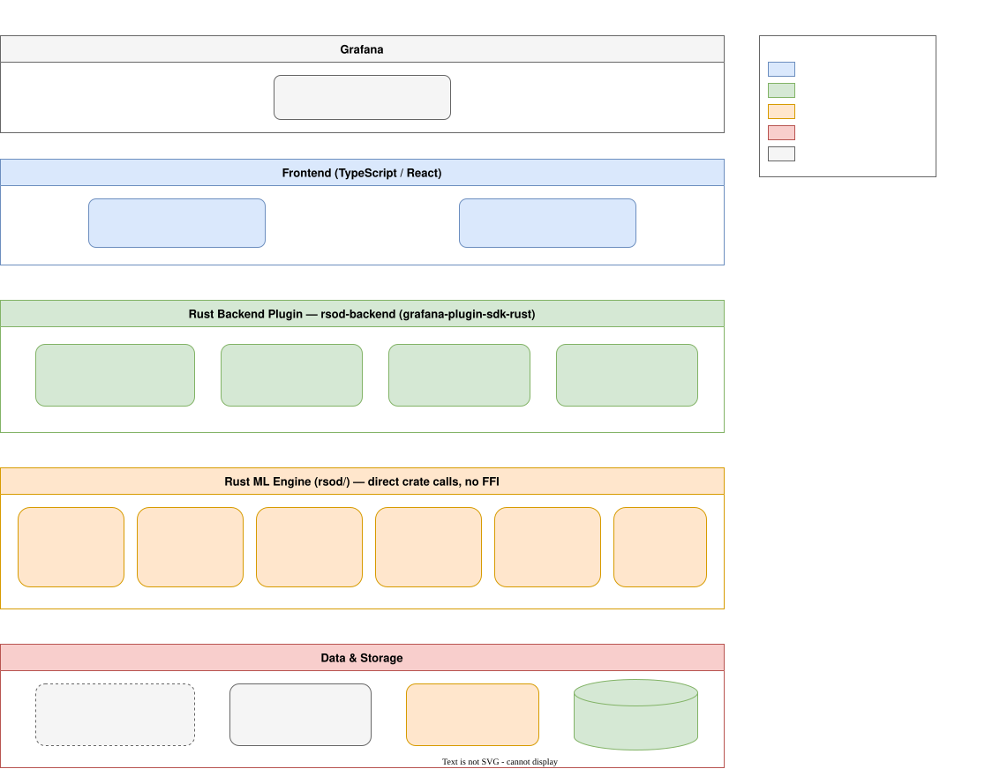

# Anomaly detection based on machine learning

Grafana supports a wide range of data sources, including Prometheus, MySQL, and even Datadog. There’s a good chance you can already visualize metrics from the systems you have set up. **Alert4ML** serves as the observability layer for SRE teams, automatically detects anomalies in time-series data based on collected data, thereby reducing the effort required by fixed-threshold methods and manual identification of abnormal system behavior.


## Architecture




## Technology Stack

- Frontend: [TS](https://www.typescriptlang.org/) / [React](https://react.dev/)
- Backend: [Rust](https://www.rust-lang.org/) / [grafana-plugin-sdk-rust](https://github.com/grafana/grafana-plugin-sdk-rust)
- Data Transform: [Arrow](https://arrow.apache.org/docs/index.html)

## Algorithm

1. [Dynamics baseline](docs/google-sre-alerting-baseline.md)
2. [perpetual](https://github.com/perpetual-ml/perpetual)
3. [Netdata-style K-means ensemble](docs/kmeans_algorithm.md)

K-means rollout guidance: [migration and rollback](docs/kmeans-migration-guide.md) ·
[replay and capacity validation](docs/kmeans-validation-and-capacity.md)

## Getting started

**Searching in the Grafana plugin catalog is not supported due to the following limitations:**

- Grafana plugins in general should not access any file system. [github issues](https://github.com/IBUMBLEBEE/grafana-alert4ml-datasource/issues/1)

~~You can download and install this grafana plugin using various options~~

- ~~From [Grafana plugin catalog](https://grafana.com/grafana/plugins/ibumblebee-alerts4ml-datasource/)~~
- ~~From [Github release page](https://github.com/IBUMBLEBEE/grafana-alert4ml-datasource/releases)~~
- ~~Using grafana cli~~

  ```shell
  grafana-cli plugins install ibumblebee-alert4ml-datasource
  ```

### Installation

1. [Download from release](https://github.com/IBUMBLEBEE/grafana-alert4ml-datasource/releases)
2. Unzip file. `unzip ibumblebee-alert4ml-datasource-<RELEASE_VERSION>-linux-amd64.zip`
3. Move to `/<GRAFANA_DATA_DIR>/plugins/ibumblebee-alert4ml-datasource`

## Configuration

1. Request a service account token. Home --> Administration --> Users and access --> Service accounts
2. Enter the address and token to access the Grafana API. Home --> Connections --> Data sources --> ibumblebee-alert4ml-datasource

### Development building and running

```shell
git clone https://github.com/IBUMBLEBEE/grafana-alert4ml-datasource.git
cd grafana-alert4ml-datasource
make
```

## Demo


## Reference

- [https://grafana.com/docs/grafana-cloud/machine-learning/dynamic-alerting/forecasting/](https://grafana.com/docs/grafana-cloud/machine-learning/dynamic-alerting/forecasting/)
- [https://docs.victoriametrics.com/anomaly-detection/](https://docs.victoriametrics.com/anomaly-detection/)
